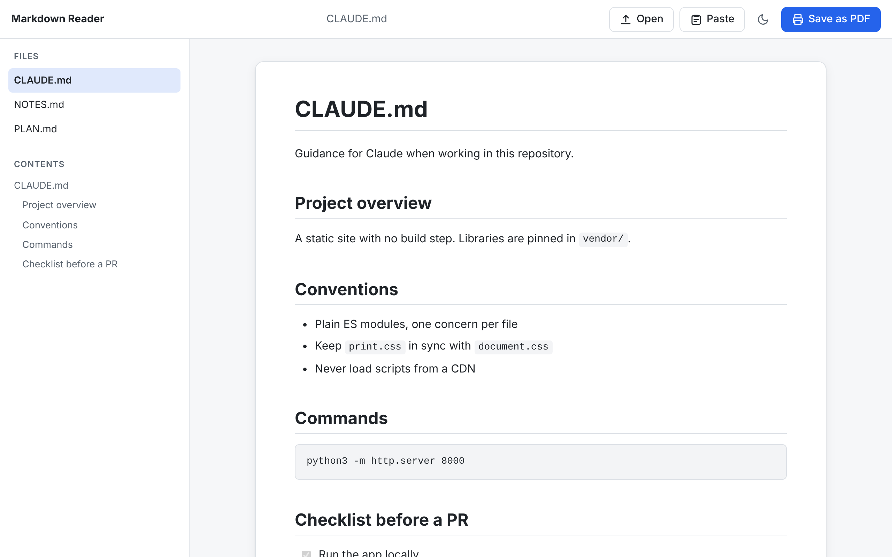
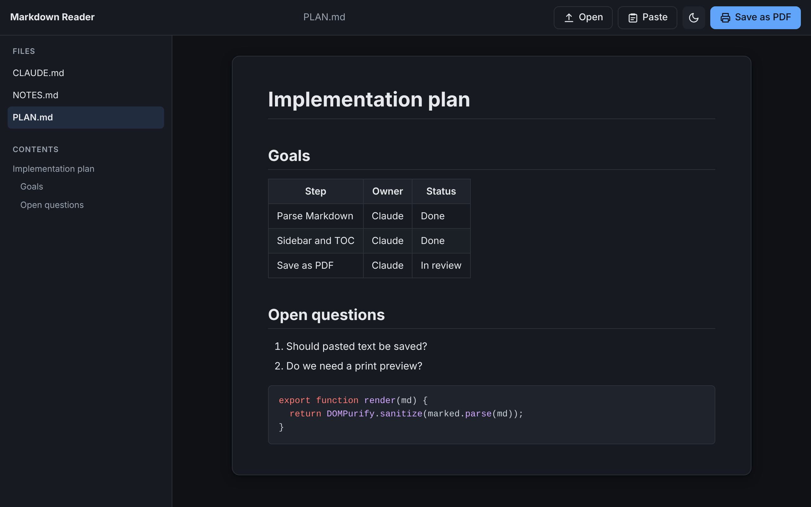
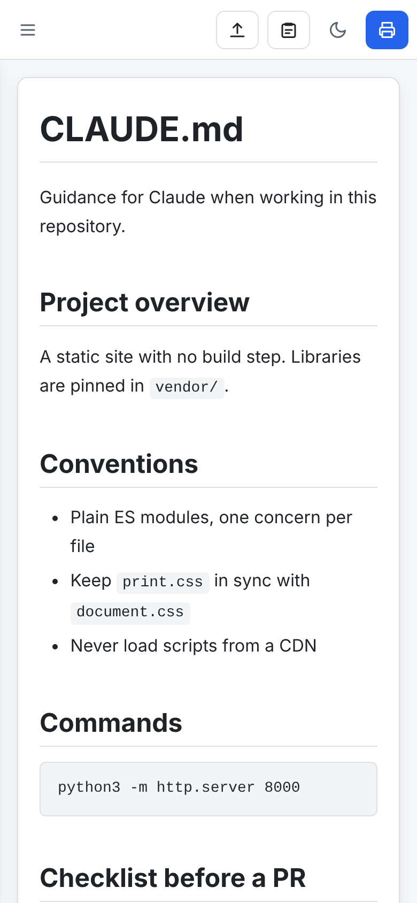

# Markdown Reader

A static web app for GitHub Pages: open Markdown files, read them as a clean
formatted document, and save that view as a PDF.

**[Open the live site](https://teerasak-mairoddee.github.io/markdown-reader/)**

Everything runs in the browser. Files are never uploaded anywhere.



| Dark theme | On a phone |
| --- | --- |
|  |  |

## Why we built this

When working with Claude, a project fills up with Markdown files: `CLAUDE.md`,
plans, specs, notes and summaries. We wanted to read them in a separate window
without switching away from the project window, and to keep several of those
documents open at once so we can move between them.

We also didn't want to spend Claude tokens on rendering or converting documents,
a job a static GitHub Pages site can do for free. And Markdown is easier to read
the way it was meant to look, with headings, tables and highlighted code, than
as raw text.

## Features

- Open `.md` files with the **Open** button or by dragging them onto the page
- **Paste** Markdown text into a box, then download it as a `.md` file or preview it in the reader
- Several files at once, listed in a sidebar, plus a table of contents
- GitHub Flavored Markdown: tables, task lists, strikethrough, autolinks
- Syntax highlighting for fenced code blocks
- Local images: drop the images with the `.md` file and `` resolves by file name
- Links between open documents (`[next](chapter-2.md)`) and to headings (`#section`)
- Light and dark themes
- **Save as PDF** prints only the document: light theme, wrapped code, page-break rules,
  expanded `<details>`, link URLs shown, and the PDF named after the file.
  Browsers without a print dialog (for example in-app browsers on phones) get a
  generated PDF download instead

## Project structure

```
index.html                 App shell
assets/
  css/
    base.css               Design tokens (light/dark), reset, buttons
    layout.css             Toolbar, sidebar, main area, responsive drawer
    document.css           Typography for rendered Markdown
    print.css              Print / PDF layout (media="print")
  js/
    main.js                Entry point, wires everything together
    store.js               In-memory state: documents, images, active doc
    loader.js              File picker and drag-and-drop
    renderer.js            Markdown -> sanitized DOM, heading ids, images, highlighting
    view.js                DOM updates: file list, TOC, document, toasts
    theme.js               Light/dark toggle
    print.js               Save as PDF (print dialog, with fallback)
    pdf-export.js          PDF file generation when printing is unavailable
    paste.js               Paste dialog: download pasted text as .md or preview it
    download.js            Shared file download helper
vendor/                    Pinned third-party libraries (no CDN, no build step)
  marked/                  marked 18.1.1 (MIT)
  dompurify/               DOMPurify 3.4.17 (Apache-2.0 / MPL-2.0)
  highlight/               highlight.js 11.11.1 (BSD-3-Clause)
  html2pdf/                html2pdf.js 0.14.0 (MIT), loaded only for the PDF fallback
samples/welcome.md         Sample document
docs/screenshots/          Screenshots used in this README
.github/workflows/         GitHub Pages deployment
```

Markdown is rendered with [marked](https://marked.js.org) and sanitized with
[DOMPurify](https://github.com/cure53/DOMPurify) before it reaches the page, so
scripts or event handlers inside a Markdown file never run.

## Run locally

ES modules need to be served over HTTP, so use any static server from the repo root:

```sh
python3 -m http.server 8000
# then open http://localhost:8000
```

## Deploy to GitHub Pages

1. Push to `main`.
2. In the repository, open **Settings > Pages** and set **Source** to **GitHub Actions**.
3. The `Deploy to GitHub Pages` workflow publishes the site to
   `https://<user>.github.io/<repo>/`.

## Saving a PDF

Press **Save as PDF** (or Ctrl/Cmd+P) and pick **Save as PDF** as the printer.
For the cleanest result, turn off **Headers and footers** in the print dialog.

If the browser has no print dialog (common in in-app browsers on phones), the
app builds the PDF itself and downloads it. Those pages are images, so text in
them cannot be selected; opening the site in Safari or Chrome gives the better
printed PDF.

## Updating the vendored libraries

```sh
npm pack marked dompurify @highlightjs/cdn-assets
# copy lib/marked.esm.js, dist/purify.es.mjs, es/highlight.min.js and the
# github / github-dark styles into vendor/, then update the versions above
```
